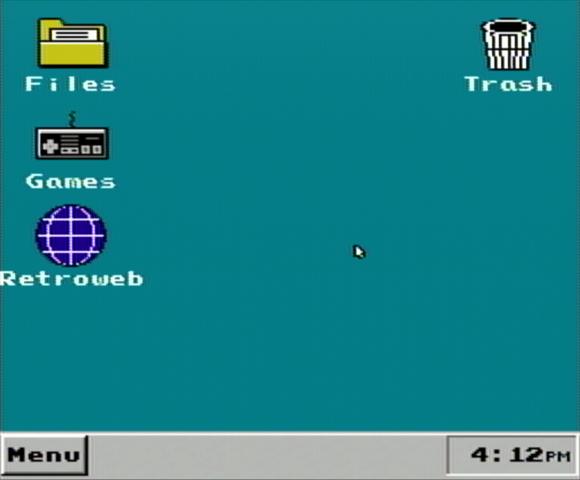

# NESPC Desktop Environment



A retro desktop environment for the NES that I made for fun. It more or less acts as a replacement for the default Everdrive N8 Pro menu ROM.

Demo video: https://youtu.be/o0s7tRcqsOs

## Repo Structure
- `desk/`: The desktop ROM
- `usbadapter/`: The USB adapter firmware for attaching a keyboard, mouse or even MIDI keyboard to your NES. Requires an RP2350-based MCU and NES controller cable.
- `nes/`: The NES side of the adapter: the 6502 driver (`nes/src/keyboard/adapter.s`) and an (untested) PS/2 keyboard driver (`ps2.s`).
- `tests/`: Test ROMs for the adapter: `kbdtest` (raw keyboard input), `linktest` (link echo) and `speedtest` (transfer rates).
- `edn8.py`: Loads a ROM (and optionally an FPGA core) onto an EverDrive N8 Pro over USB

## Filesystem

Everything goes under `nespc/` on the Everdrive SD card.
- `apps/`: Desktop (`.dx`) and standalone apps (`.nes`/`.rbf`)
- `desktop/`: Desktop shortcuts (`.lnk`)
- `menu/`: Menu shortcuts (also `.lnk`)
- `games/`: Regular NES/GB ROMs that are shown in the Games window
- `trash/`: The trash bin
- `system/`: Everything else

## Hardware
- An Everdrive N8 Pro (the FPGA is heavily utilized to make this thing work well)
- A modded NES controller cable hooked up to an RP2350-based MCU for keyboard and mouse support
- (Optional) [NESCD](https://github.com/ThroatyMumbo/NESCD) for disc integration (if you're willing to put that contraption together; not sold in your local Walmart)

Realistically, the Everdrive is the only thing you need to play around with this. The NES controller acts as a mouse.

## Build

Connect the Everdrive N8 Pro USB to your machine and run:
```
make -C desk run
```

## Credits
- [nes86](https://github.com/decrazyo/nes86) (GPLv3): the 8x8 font (`nes/data/background.chr`) and the keyboard framework (`nes/include/const.inc`, `keyboard.inc`).
- [krikzz/EDN8-PRO](https://github.com/krikzz/EDN8-PRO): the EverDrive N8 Pro base FPGA sources. They are fetched at build time and are not included here; `rtl/base.patch` adds the menu-return hooks Desk's mapper uses.
- [150+ Mouse Cursors Pack 8x8](https://kaboff.itch.io/100-mouse-cursors-pack-8x8) by KabGames ([CC BY 4.0](https://creativecommons.org/licenses/by/4.0/)): the mouse cursors (`desk/assets/cursors.png`), unchanged.

## FAQ

### Is this Windows?
No, it just looks similar. Unlike my [WinCE64](https://github.com/ThroatyMumbo/WinCE64) project, this doesn't run anything Windows-related and isn't compatible in any way. Executables are `.dx` format rather than `.exe` and are a lot more stripped down and simple than a typical executable.
